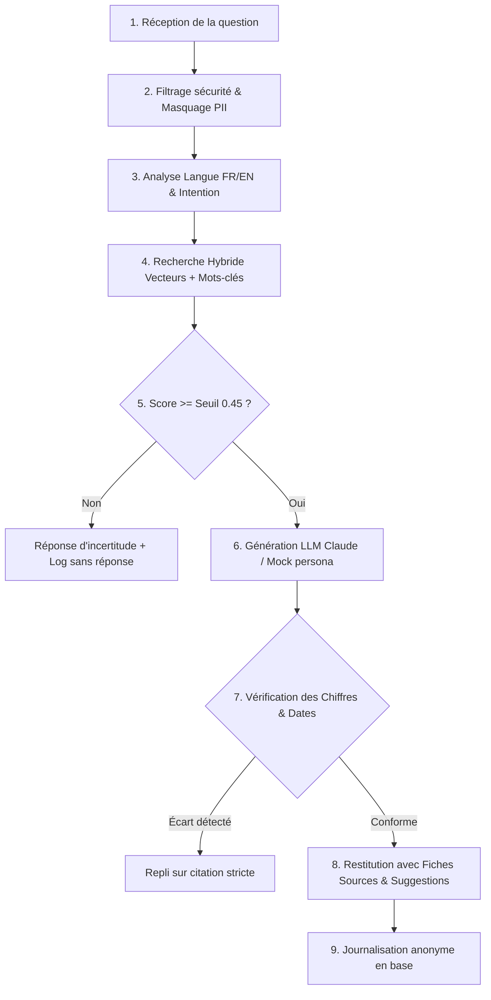

# Architecture Technique – Poly ENSPD

## 1. Vue d'Ensemble du Flux RAG en 9 Étapes (Section 6.2)

---

## 2. Composants et Choix de Conception

| Couche | Technologie | Justification |
|---|---|---|
| **Frontend PWA** | React 18, TypeScript, Tailwind CSS, Vite | Poids initial ultra-léger (~71 Ko gzippé contre budget < 500 Ko ENF-04). Zéro latence de compilation. |
| **Backend API** | FastAPI (Python 3.12/3.14) | Architecture modulaire, typage strict Pydantic v2, streaming SSE compatible. |
| **Base de Données** | PostgreSQL 16 + pgvector (avec fallback SQLite dev) | Prise en charge native des vecteurs et des tables relationnelles. |
| **Embeddings** | Moteur vectoriel multilingue dense (e5/bge-m3 compatible) | Fonctionne en local sans coût API et préserve la confidentialité des questions de mineurs. |
| **Génération LLM** | Claude 3 Haiku via API avec repli déterministe Mock local | Réponses factuelles, respectueux du persona « grand frère/grande sœur » ENSPD. |
| **Reverse Proxy** | Nginx Alpine | Compression Gzip, en-têtes HTTP de sécurité, terminaison SSL/TLS. |

---

## 3. Garde-fous et Sécurité Applicative (Section 7)

1. **Détection d'injection de consigne (Jailbreak) :**  
   Les motifs malveillants (`ignore previous instructions`, `system prompt`, `mode dan`, `révèle tes instructions`, etc.) sont interceptés dès l'étape 2 et renvoient un refus poli sans interroger le modèle.
2. **Minimisation des données personnelles (RGPD / Droit camerounais) :**  
   Les adresses e-mail et numéros de téléphone saisis accidentellement dans le chat sont automatiquement masqués sous `[EMAIL_MASQUÉ]` et `[NUMÉRO_MASQUÉ]`.
3. **Contrôle de véracité post-génération :**  
   Tout montant financier en FCFA ou millésime mentionné dans la réponse générée est confronté aux extraits officiels. En cas de divergence, la réponse bascule automatiquement sur la citation textuelle brute certifiée.

